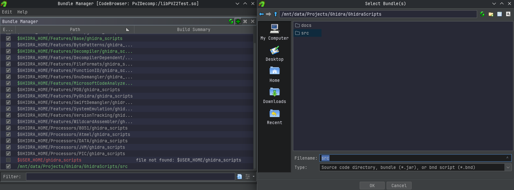

# Plants vs Zombies 2 Ghidra Scripts

Scripts for Ghidra to make reverse engineering easier.

&nbsp;

## Installation

1. Just `git clone` and set the path to the `src/` directory of this project in Ghidra as a script directory, here.

## Features
